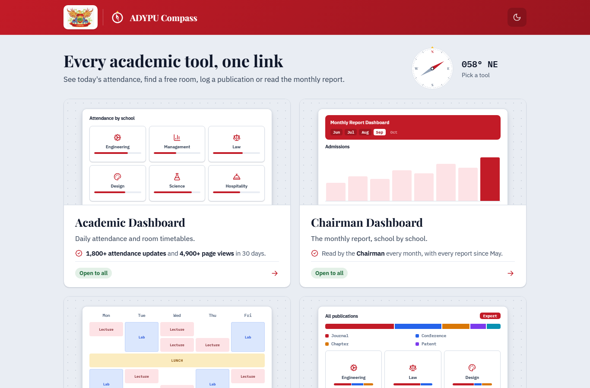
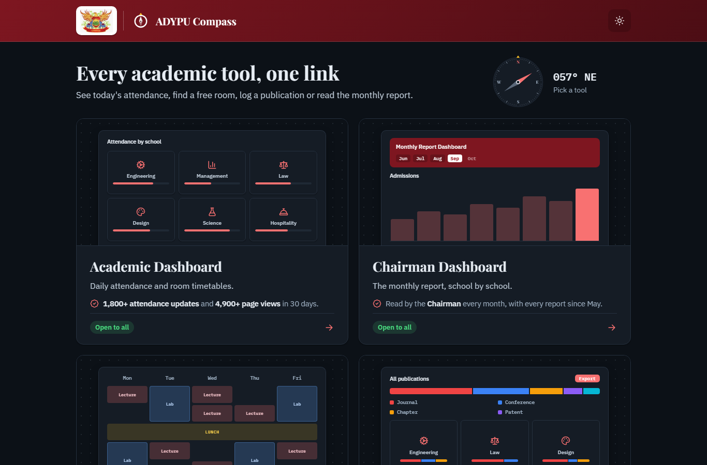
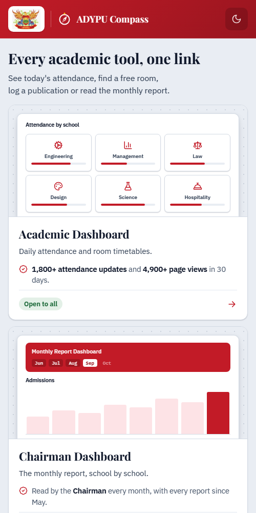

# ADYPU Compass

One page linking every academic tool at Ajeenkya D Y Patil University.

Live site: <https://adypu.pages.dev/>

#### Compass, desktop, light



## The tools

| Tool | What it is |
| --- | --- |
| Academic Dashboard | Daily attendance and room timetables |
| Chairman Dashboard | The monthly report, school by school |
| Timetable Generator | Clash-free timetables for Engineering |
| Research Publications | Papers, books and patents, with proof |

## What the page does

- A compass in the header whose needle settles when the page loads.
- A hero compass whose needle follows the pointer on a spring, points at the card under it, and reads out the bearing and the tool's name.
- Each card has a small CSS preview of its tool and a one-line proof point with real figures.
- Light and dark themes, remembered between visits.
- Works on a phone; the cards stack in one column.

#### Compass, desktop, dark



#### Compass, phone



## Add a tool

1. Copy one `<a class="card">` block in `index.html`.
2. Change its name, line, tag, preview and link.

## Run it locally

Plain HTML, CSS and a few lines of JS. No build step. Serve the folder with any static server:

```bash
php -S localhost:8100
```

Open <http://localhost:8100/>.

## Link back from another site

Every ADYPU site can load one script to get a "Back to ADYPU Compass" button and the feedback note ("For feedback or changes, contact the Dean Academics Office."):

```html
<script src="https://adypu.pages.dev/embed/compass-link.js" defer></script>
```

- The button sits in the bottom-left corner and shrinks to the compass and one word on a phone.
- It takes each tool's own look: its colours, corners and type. The look is picked from the site's address, and follows the site's dark mode where it has one.
- The arrow beside it opens a menu of the other tools, so you can go straight from one to another. The menu can also keep the button small, as just the compass.
- Scrolling down folds the label away; scrolling up brings it back. On a phone it steps aside while you type.
- Coming back, Compass points its needle at the tool you came from and marks its card for a moment.
- The script reads and sends nothing. The only thing it keeps is the "keep it small" choice, in your browser.
- Change the wording, the links or a look once in `embed/compass-link.js` and every site picks it up within the hour.

Options, as attributes on the tag:

| Attribute | What it does |
| --- | --- |
| `data-link="off"` | Leaves the button out and keeps only the note |
| `data-skin="daybook"` | Picks the look by hand: `compass`, `daybook`, `report`, `timetable` or `research` |
| `data-position="right"` | Moves the button to the bottom-right corner |
| `data-guard="forms"` | Asks before leaving when a form on the page has been edited and not submitted |

A site with its own idea of unsaved work can tell the button with `ADYPUCompass.setUnsaved(true)`, and `false` once it is saved. Add `data-cx-ignore` to a form, such as a filter, that should never count.

## Project layout

| Path | What it is |
| --- | --- |
| `index.html` | The page and its cards |
| `css/` | Styles, light and dark |
| `js/compass.js` | The hero compass and its needle |
| `js/theme.js` | The light and dark toggle |
| `embed/compass-link.js` | The script other sites include |
| `_headers` | Cache rules Cloudflare Pages applies to that script |
| `img/` | The Compass mark, logo and share image |
| `docs/screenshots/` | Screenshots used above |

## Deploy

Hosted on Cloudflare Pages. Every push to `main` goes live.
